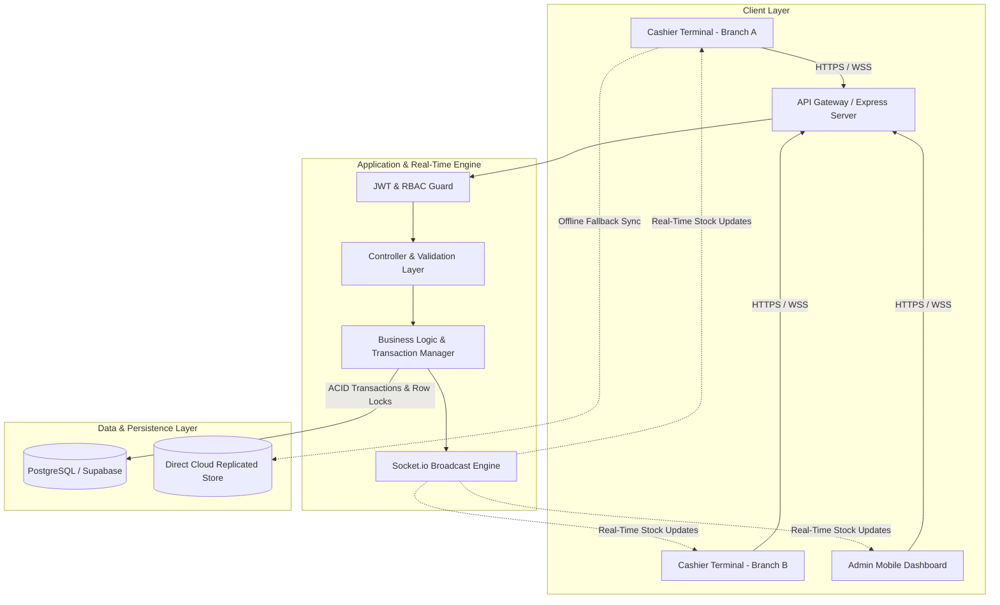

<div align="center">

# 💎 NexPOS — Enterprise Multi-Branch POS & Inventory Management System

**A high-performance, concurrency-safe, full-stack ERP & Point of Sale platform engineered for multi-branch retail chains and mobile accessory stores.**

[](https://www.typescriptlang.org/)
[](https://react.dev/)
[](https://nodejs.org/)
[](https://www.postgresql.org/)
[](https://socket.io/)
[](https://tailwindcss.com/)

[System Architecture](#-system-architecture) • [Engineering Highlights](#-key-engineering-highlights) • [Features](#-core-features) • [Installation](#-getting-started) • [Portfolio Showcase](#-portfolio-context)

</div>

---

## 📌 Executive Summary

**NexPOS** is an enterprise-grade retail Point of Sale (POS) and inventory orchestration system. Built from the ground up to eliminate common retail failure points—such as race-condition double-selling across concurrent cashier lanes, stock discrepancies across distributed branches, and clunky hardware printing setups.

It features an **atomic transaction engine**, **real-time WebSocket stock synchronization**, an **isolated portrait thermal sticker printing system**, and an **offline-resilient dual-layer data architecture**.

---

## 🏛️ System Architecture



---

## ⚡ Key Engineering Highlights

### 1. 🛡️ Concurrency-Safe Inventory Deduction (Race Condition Immunity)
* **The Problem:** In high-volume retail stores with multiple cashiers selling the last item in stock simultaneously, standard read-then-write mechanisms lead to double-selling and negative stock balances.
* **The Solution:** Implemented database-level pessimistic locking (`SELECT ... FOR UPDATE`) coupled with atomic conditional SQL decrements:
  ```sql
  UPDATE product_branch_data
  SET quantity = quantity - $soldQty
  WHERE "productId" = $1 AND "branchId" = $2 AND quantity >= $soldQty;
  ```
  If zero rows are affected, the transaction automatically rolls back and returns an immediate `409 Out of Stock` error with the current available balance, guaranteeing 100% stock integrity under intense concurrent loads.

### 2. ⚡ Real-Time Multi-Lane Synchronization (WebSockets)
* Stock changes committed by lane 1 are instantaneously pushed via **Socket.io** to all other lanes and branches within < 50ms.
* Cashiers see live inventory badges dynamically transition between *In Stock*, *Low Stock Warning*, and *Sold Out* without refreshing their browsers.

### 3. 🏷️ Precision Thermal Sticker & Barcode Engine
* Custom-built **Portrait Thermal Label Printing Engine** specifically calibrated for standard jewelry and mobile accessory label rolls (**38mm × 28mm**).
* Uses strict `@page { size: 38mm 28mm portrait; margin: 0; }` styling inside an isolated sandbox iframe, eliminating all browser header/footer URL artifacts (`.vercel.app` / timestamps) and ensuring labels **never spill over onto consecutive stickers**.
* Formatted in a clean vertical 4-element hierarchy:
  1. Centered High-Density QR Code
  2. Product Name (Arabic/English)
  3. Unique Serial Number / SKU
  4. Raw Wholesale / Retail Level-4 Price
* Includes dual emission: Browser Direct Printing + Native **TSPL (Thermal Printer Command Stream)** for industrial hardware printers (e.g., Xprinter XP-246B).

### 4. 🔄 Offline-First Resilience & Dual-Layer Data Sync
* Designed for intermittent internet connectivity.
* The frontend utilizes a reactive local cache coupled with an abstraction layer that seamlessly falls back to direct cloud REST endpoints if the primary API gateway experiences network delays, flushing queued transactions upon reconnection.

---

## 🚀 Core Features

| Feature Module | Capabilities |
| :--- | :--- |
| **Cashier POS Terminal** | Ultra-fast barcode scanning, instant search, customer quick-assignment, and multi-mode payment (Cash, Visa, InstaPay, Mobile Wallet, Partial / Deferred). |
| **Inventory & Stock Management** | Multi-branch stock allocation, low-stock threshold alerts, restock workflows, bulk product operations, and automated SKU/Serial generation. |
| **Customer CRM & Debt Ledger** | Automated customer profile creation on invoice checkout, customer statement generation (*كشف حساب*), and bulk installment debt settlement. |
| **Invoicing & Returns** | Batch cascade deletion, itemized profit/cost calculation, real-time favorite invoice pinning, and date/month timeline filters. |
| **Thermal Printing Suite** | Single-click barcode label printing, custom copy count selection, live print previews, and TSPL hardware file export. |
| **Branch Isolation & Security** | Strict branch-level data sandboxing for employees; overarching cross-branch supervision and financial analytics for Super Admins. |

---

## 🛠️ Technology Stack Breakdown

### Frontend
- **Framework:** React 19 with TypeScript
- **Bundler:** Vite
- **Styling:** Tailwind CSS + Radix UI Primitives (Shadcn UI architecture)
- **Icons & Graphics:** Lucide React, QRCodeSVG
- **Real-Time Client:** Socket.io-client
- **State Management:** Reactive Custom Store with LocalStorage synchronization

### Backend
- **Runtime:** Node.js (v18+) & TypeScript
- **Framework:** Express.js
- **ORM & Data Layer:** TypeORM with PostgreSQL (Hosted on AWS via Supabase)
- **Real-Time Gateway:** Socket.io
- **Security:** JWT (Access & Refresh Tokens), Bcrypt password hashing, Helmet, CORS, Rate Limiting
- **Validation:** Zod schema enforcement

---

## 📁 Repository Structure

```text
Accessories-Store/
├── backend/                  # Enterprise Express + TypeORM API
│   ├── src/
│   │   ├── config/           # Database & environment configurations
│   │   ├── common/           # Middleware, JWT, exceptions, socket helpers
│   │   ├── db/               # Seeds, migrations, connection pools
│   │   └── modules/          # Domain modules (auth, invoices, products, etc.)
│   ├── package.json
│   └── README.md             # Detailed Backend Documentation
│
├── frontend/                 # React 19 + Vite POS Web Application
│   ├── src/
│   │   ├── components/       # Reusable UI primitives & layouts
│   │   ├── pages/            # POS, Products, Invoices, QRCodes, Suppliers
│   │   ├── services/         # API abstraction, reactive store, printer engine
│   │   └── types/            # Strict TypeScript interfaces
│   ├── package.json
│   └── README.md             # Detailed Frontend Documentation
│
└── README.md                 # Project Overview (You are here)
```

---

## ⚙️ Getting Started

### Prerequisites
- **Node.js** >= 18.x
- **PostgreSQL** >= 14.x or a **Supabase** database instance
- **npm** or **yarn**

### 1. Clone the Repository
```bash
git clone https://github.com/John-Remoun/Accessories-Store.git
cd Accessories-Store
```

### 2. Backend Setup
```bash
cd backend
npm install

# Copy environment variables
cp .env.example .env

# Run database seeds (creates essential branches and admin users)
npm run seed

# Start development server
npm run dev
```

### 3. Frontend Setup
```bash
cd ../frontend
npm install

# Start Vite dev server
npm run dev
```

The POS interface will be live at `http://localhost:5173`.

---

## 💼 Portfolio Context & Data Privacy

> [!NOTE]
> **Data Privacy Notice:** All business names, customer contact records, real store numbers, and proprietary credentials have been fully sanitized and decoupled from this public repository. The repository contains sanitized mock seeds and demonstration accounts designed purely for architectural evaluation, code review, and portfolio presentation.

---

## 👤 Author & Engineering Credits

Developed with a focus on high-performance full-stack web engineering, transaction safety, and clean software architecture.

- **GitHub:** [@John-Remoun](https://github.com/John-Remoun)
- **LinkedIn:** [John Remoun](https://linkedin.com)
- **Project Domain:** Retail ERP & Mobile POS Solutions
