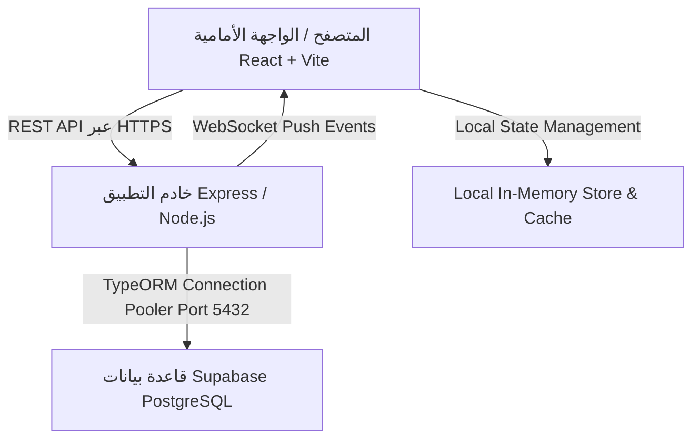

# التقرير الفني الشامل لمعمارية النظام وحل أزمة استهلاك البيانات (Supabase Egress) والنزاهة المحاسبية

---

## فهرس المحتويات
1. [نظرة عامة وشاملة على المشروع ومعماريته](#1-نظرة-عامة-وشاملة-على-المشروع-ومعماريته)
2. [المشاكل والعيوب التي واجهت النظام بالتفصيل والملفات المسؤولة عنها](#2-المشاكل-والعيوب-التي-واجهت-النظام-بالتفصيل-والملفات-المسؤولة-عنها)
3. [الحل الهندسي الشامل وتفاصيل التعديلات البرمجية بالكود](#3-الحل-الهندسي-الشامل-وتفاصيل-التعديلات-البرمجية-بالكود)
4. [نتائج الاختبارات والتحقق البرمجي النهائي](#4-نتائج-الاختبارات-والتحقق-البرمجي-النهائي)

---

## 1. نظرة عامة وشاملة على المشروع ومعماريته

### أ. طبيعة النظام والهدف منه
المشروع عبارة عن **نظام متكامل لإدارة نقاط البيع والمخازن متعدد الفروع (Multi-Branch POS & Inventory Management System)** مصمم خصيصاً لسلسلة متاجر ومحلات إكسسوارات الهواتف المحمولة والإلكترونيات. يتميز النظام بالقدرة على الربط بين الفروع في الوقت الفعلي مع فرض عزل إداري صارم بين الفروع وحماية التكاليف وهوامش الأرباح للمديرين فقط.

### ب. البنية التقنية (Tech Stack)



1. **الواجهة الأمامية (Frontend):**
   - **Framework**: React 18 مبني بواسطة Vite لأقصى سرعة أداء.
   - **اللغة**: TypeScript لضمان الأمان البرمجي وتطابق النماذج (Strict Typing).
   - **التصميم وتجربة المستخدم**: Tailwind CSS مدعومة بـ Lucide React Icons و Radix UI primitives لإنشاء واجهة حديثة وسريعة الاستجابة.
   - **إدارة الحالة (State Management)**: مخزن حالة مركزي عميل في `frontend/src/services/store.ts` يدير التزامن مع الخادم ومزامنة المخزون والمدفوعات.
   - **المصادقة والصلاحيات**: سياق مصادقة مركزي `AuthContext.tsx` يدير رموز الوصول `access_token` و `refresh_token`.
   - **الرسوم البيانية والإحصائيات**: Recharts لرسم وتوضيح الأداء المالي والمبيعات اليومية والشهرية.

2. **الخادم والباك إند (Backend):**
   - **بيئة التشغيل**: Node.js مع Express Framework مكتوب بالكامل بـ TypeScript.
   - **محرك قواعد البيانات (ORM)**: TypeORM لإدارة الكيانات والعلاقات، والمعاملات الذرية (Transactions)، وعمليات القفل المتشائم (Pessimistic Locking).
   - **التزامن اللحظي (Real-Time Communication)**: خادم Socket.IO داخلي يبث التحديثات الفورية (مثل إصدار الفواتير ونفاد المخزون) لكافة الأجهزة المتصلة دون الحاجة لإعادة تحميل الصفحة.
   - **التحقق من البيانات (Validation)**: مكتبة Zod لتدقيق هياكل الطلبات (Request Payloads) ومنع إدخال بيانات غير متطابقة أو أرقام سلبية.

3. **قاعدة البيانات والبنية السحابية (Cloud & Database):**
   - **الاستضافة**: Supabase PostgreSQL السحابية (AWS eu-west-1).
   - **الاتصال**: يتم الاتصال عبر مجمّع الاتصالات (Supabase Connection Pooler IPv4) عبر المنفذ `5432` لتقليل زمن استجابة الاتصال وإدارة الموارد.
   - **الأمان وسياسات الصفوف**: تفعيل Row Level Security (RLS) وتشفير الحقول الحساسة وفصل البيانات بين الفروع.

### ج. الوحدات والوظائف الرئيسية للنظام

1. **شاشة نقطة البيع السريعة (POS Screen):**
   - بيع المنتجات العادية ذات المخزون التراكمي (Aggregate Products).
   - بيع المنتجات ذات السيريال أو كود الـ QR المميز (Serialized Physical Items) مع فحص عدم التكرار.
   - خيارات دفع مرنة: نقدي (Cash)، فودافون كاش (Vodafone Cash)، إنستاباي (InstaPay)، الدفع المجزأ (Split Payments)، والبيع الآجل (الديون/الشكك).
   - الربط المباشر مع واتساب لإرسال الإيصالات للعميل بضغطة زر.
2. **عزل الفروع والصلاحيات (Branch Isolation & Security):**
   - عزل صارم: الموظف العادي يرى مبيعات ومخزون ومصروفات فرعه فقط، مع حجب تكاليف الشراء وهوامش الأرباح عنه تلقائياً.
   - صلاحيات المدير العام (Admin): يمتلك رؤية شمولية لكافة الفروع، إدارة التكاليف، إنشاء ونقل المستخدمين، والوصول للتقارير المجمعة.
3. **إدارة المخزون والقطع الفريدة (Inventory & QR Physical Items):**
   - تتبع رصيد المنتج العادي في كل فرع عبر جدول `product_branch_data`.
   - توليد وتتبع القطع الفيزيائية برمز QR وسيريال مميز عبر جدول `physical_items`.
   - حماية المخزون من البيع المزدوج باستخدام الخصم المشروط الذري في الـ SQL.
4. **دفتر الديون وكشوف حسابات العملاء (Customer Ledger & Debt Settlement):**
   - ربط الفواتير الآجلة بالعميل عبر رقم الهاتف وتتبع إجمالي المشتريات وإجمالي المتبقي.
   - تسوية الديون تلقائياً بأقدم الفواتير أولاً (FIFO Settlement).
5. **المصروفات الثابتة والتركيبات (Fixed Expenses & Compositions):**
   - تسجيل إيجارات ومرتبات وفواتير الكهرباء لكل فرع واحتسابها يومياً وشهرياً.
   - حساب تكلفة المنتجات المركبة والتغليف.

---

## 2. المشاكل والعيوب التي واجهت النظام بالتفصيل والملفات المسؤولة عنها

### المشكلة الأولى: استهلاك البيانات الكارثي لـ Supabase (أزمة الـ 14 GB Egress)
- **الملفات المسؤولة:**
  - `backend/src/modules/invoices/invoice.service.ts`
  - `frontend/src/services/store.ts`
  - `frontend/src/services/api.ts`
- **التفاصيل والأسباب:**
  - قامت قاعدة بيانات Supabase بتسجيل استهلاك باندويث تخطى **14 جيجابايت**، متجاوزاً الحد المجاني المسموح به (5 جيجابايت) بمراحل ومسبباً خطر توقف النظام بالكامل.
  - بالفحص الجنائي تبين أن الاستعلام الرئيسي للفواتير `getAllInvoices` و `getInvoicesByBranch` كان ينفذ:
    ```typescript
    this.invoiceRepo.find({ relations: ['invoiceItems'] })
    ```
    حيث كان يقوم بجلب كل الفواتير التاريخية من اليوم الأول للمتجر، ويدمج مع كل فاتورة كافة بنودها ومشتملاتها (`invoiceItems` التي تجاوزت 900+ بند).
  - كانت كل استجابة للفرع تنقل حوالي **1.5 ميجابايت** من البيانات الخام في الطلب الواحد.
  - زاد الطين بلة وجود مزامنة دورية تلقائية في `store.ts` تعمل كل **3 دقائق** على المزامنة السريعة، وكل **7 دقائق** على المزامنة الكاملة، بالإضافة إلى تشغيلها فوراً عند كل انتقال إلى نافذة المتصفح (`window focus`)، وعند كل عودة للإنترنت (`window online`)، وعند استعادة اتصال الـ WebSocket، وعند حفظ أي عملية بيع.
  - مع فتح المتصفح على عدة أجهزة في الفروع المختلفة، كان يتم تحميل مئات الميجابايت كل ساعة من الـ JSON المتضخم عبر شبكة Supabase، مما استنزف 14 جيجابايت سريعاً.

### المشكلة الثانية: التصفح غير المحدود وغياب القيود في الخادم
- **الملفات المسؤولة:**
  - `backend/src/modules/invoices/invoice.controller.ts`
  - `frontend/src/pages/invoices/Invoices.tsx`
- **التفاصيل:**
  - لم يكن هناك تقسيم صفحات على مستوى الخادم (Server-Side Pagination). كانت الواجهة الأمامية تطلب الفواتير بدون أي معيار `limit` أو `page`، وتقوم بعمل تصفح محلي في المتصفح. وإذا طلب العميل أي عدد لم تكن هناك حدود قصوى مفروضة من الخادم.

### المشكلة الثالثة: انهيار التقارير المالية عند تقييد مزامنة الفواتير
- **الملفات المسؤولة:**
  - `frontend/src/pages/dashboard/Reports.tsx`
  - `frontend/src/pages/dashboard/MasterDashboard.tsx`
  - `frontend/src/pages/dashboard/Branches.tsx`
  - `frontend/src/pages/customers/Customers.tsx`
- **التفاصيل:**
  - لحل أزمة الـ Egress، تم في البداية تقييد ما يتم تخزينه في `store.invoices` بـ 50 فاتورة حديثة فقط.
  - أدى ذلك إلى كارثة محاسبية فورية: صفحات التقارير ولوحات التحكم كانت تحسب إجمالي مبيعات المتجر وديونه التاريخية عبر:
    ```typescript
    store.getInvoices().reduce(...)
    ```
    وبالتالي، بدلاً من حساب مبيعات المتجر بالكامل، أصبحت التقارير تحسب مبيعات آخر 50 فاتورة فقط! فانهارت أرقام الأرباح والديون والإحصائيات وأصبحت تعرض أرقاماً وهمية ومبتورة.

### المشكلة الرابعة: عيوب التوقيت والشهور وتسريب الـ Egress في نقطة تجميع التقارير
- **الملفات المسؤولة:**
  - `backend/src/modules/invoices/invoice.service.ts` (`getReportsSummary`)
  - `frontend/src/pages/dashboard/MasterDashboard.tsx`
- **التفاصيل:**
  - تم بناء نقطة نهاية خادمة لتجميع التقارير `getReportsSummary` لتعويض نقص الفواتير في الذاكرة، لكنها احتوت على عيوب خطيرة:
    1. **فروق التوقيت (Timezone Shift)**: يتم تخزين تواريخ الفواتير بصيغة UTC ISO في قاعدة البيانات. في مصر (توقيت القاهرة UTC+2 أو UTC+3)، الفاتورة التي تصدر في المتجر الساعة 12:30 بعد منتصف الليل يوم 1 أكتوبر يتم تسجيلها كـ `2026-09-30T21:30:00Z`. وعندما كان السيرفر ينفذ `new Date(inv.date).getMonth()` كان يعتبرها تابعة ليوم 30 سبتمبر، فتسقط من مبيعات شهر أكتوبر تماماً وتظهر في الشهر السابق!
    2. **تضارب ترقيم الشهور (Month-Indexing Bug)**: دالة `Date.getMonth()` في الجافاسكريبت تبدأ من `0` (يناير = 0، أكتوبر = 9). الواجهة في `Branches.tsx` كانت ترسل `currentMonth + 1` (شهر 10)، بينما `MasterDashboard.tsx` كانت ترسل `currentMonth` (شهر 9). وكان الباك إند يقارن مباشرة دون تطبيع، فكانت الإحصائيات اليومية تظهر فارغة في أحدهما!
    3. **تسريب الـ Egress بين السيرفر وSupabase**: عند طلب التقارير بدون تاريخ، كان السيرفر ينفذ:
       ```typescript
       qb.select([...]).getMany()
       ```
       بدون أي شرط زمني في SQL، مما يعني أن سيرفر Node.js كان يقوم بتحميل مئات الآلاف من الفواتير من Supabase إلى ذاكرة السيرفر ليقوم بتجميعها داخل حلقة `for`، فاستمر تسريب الباندويث عبر منفذ قاعدة البيانات.

### المشكلة الخامسة: عيوب تسوية ديون العملاء والتنازع المتزامن
- **الملفات المسؤولة:**
  - `backend/src/modules/invoices/invoice.service.ts` (`payCustomerDebt`)
  - `backend/src/modules/invoices/invoice.controller.ts`
- **التفاصيل:**
  - لم تكن عملية سداد ديون العميل معزولة بقفل متشائم؛ ففي حال قيام موظفين بتسجيل دفعة لنفس العميل في فرعين بالتزامن، كان يتم خصم نفس المبلغ من الفاتورة مرتين.
  - كان كشف الحساب يبحث برقم الهاتف أو الاسم عبر شرط `OR customerName`، مما تسبب في خلط فواتير العملاء أصحاب الأسماء المتشابهة (مثل "محمد أحمد") ودمج ديونهم معاً.

---

## 3. الحل الهندسي الشامل وتفاصيل التعديلات البرمجية بالكود

تم حل كافة المشكلات السابقة بحلول هندسية جذرية محكمة تم دمجها واختبارها وتثبيتها:

### أ. تقييد التصفح وإسقاط بنود الفواتير الثقيلة (Lightweight Invoices & Bounded Pagination)
1. في [invoice.service.ts](file:///d:/Projects/Accessories%20Store/backend/src/modules/invoices/invoice.service.ts):
   - تم تعديل `getPaginatedInvoices` بحيث تفرض حداً أقصى صارماً لا يتجاوز 100 فاتورة مهما طلب العميل:
     ```typescript
     const page = Math.max(1, Number(options.page) || 1);
     const limit = Math.min(100, Math.max(1, Number(options.limit) || 20));
     const skip = (page - 1) * limit;
     ```
   - تم إسقاط علاقة `invoiceItems` تماماً من قوائم التصفح، وإرجاع مصفوفة فارغة `items: []` مع بيانات الترويسة الأساسية للفاتورة فقط. انخفض حجم الفاتورة في الشبكة من **1.5 KB إلى أقل من 300 بايت** (توفير أكثر من 85%).
   - تم تعديل الاستعلامات القديمة `getAllInvoices` و `getInvoicesByBranch` لحذف علاقة `invoiceItems` وإضافة كاش محلي بالذاكرة لمدة 15 ثانية للحفاظ على التوافقية مع أي استدعاءات قديمة.
2. تم بناء استعلام التحميل الكسول للفاتورة الواحدة `getInvoiceById`:
   - يتم تحميل بنود الفاتورة `invoiceItems` فقط وحصرياً عند قيام الكاشير بالنقر على زر عرض الإيصال أو تعديل الفاتورة بالمعرف الفريد الخاص بها.

### ب. منع الطلبات المتزامنة والتخزين المؤقت في الواجهة الأمامية
في [api.ts](file:///d:/Projects/Accessories%20Store/frontend/src/services/api.ts):
تم إنشاء نظام تخزين مؤقت ومنع للطلبات المزدوجة المتزامنة (In-Flight Deduplication & 30s Detail Cache):
```typescript
const invoiceDetailCache = new Map<string, { data: any; timestamp: number }>();
const invoiceDetailInFlight = new Map<string, Promise<any>>();

getInvoiceById: (id: string): Promise<any> => {
  const cleanId = id.trim();
  // إرجاع الفاتورة من الكاش إذا تم طلبها خلال آخر 30 ثانية
  const cached = invoiceDetailCache.get(cleanId);
  if (cached && Date.now() - cached.timestamp < 30000) {
    return Promise.resolve(cached.data);
  }
  // دمج الطلبات المتزامنة لنفس الفاتورة في Promise واحد
  const inFlight = invoiceDetailInFlight.get(cleanId);
  if (inFlight) return inFlight;

  const p = request<any>(`/invoices/${cleanId}`)
    .then((data) => {
      invoiceDetailCache.set(cleanId, { data, timestamp: Date.now() });
      invoiceDetailInFlight.delete(cleanId);
      return data;
    })
    .catch((err) => {
      invoiceDetailInFlight.delete(cleanId);
      throw err;
    });
  invoiceDetailInFlight.set(cleanId, p);
  return p;
}
```

### ج. حل أزمة التقارير: حصر الاستعلام في SQL ودعم التوقيت والشهور
في [invoice.service.ts](file:///d:/Projects/Accessories%20Store/backend/src/modules/invoices/invoice.service.ts):
1. **دعم توقيت القاهرة الحقيقي (`getCairoDateParts`)**:
   تمت إضافة دالة تستخدم `Intl.DateTimeFormat` الرسمية لتحديد اليوم والشهر والسنة بتوقيت `Africa/Cairo` بدقة متناهية:
   ```typescript
   export function getCairoDateParts(dateVal: string | Date | undefined): { year: number; month: number; day: number } | null {
     if (!dateVal) return null;
     const d = new Date(dateVal);
     if (isNaN(d.getTime())) return null;
     try {
       const formatter = new Intl.DateTimeFormat('en-US', {
         timeZone: 'Africa/Cairo',
         year: 'numeric',
         month: 'numeric',
         day: 'numeric',
       });
       const parts = formatter.formatToParts(d);
       let year = d.getFullYear();
       let month = d.getMonth();
       let day = d.getDate();
       for (const p of parts) {
         if (p.type === 'year') year = parseInt(p.value, 10);
         if (p.type === 'month') month = parseInt(p.value, 10) - 1; // 0-indexed: 0 = يناير
         if (p.type === 'day') day = parseInt(p.value, 10);
       }
       return { year, month, day };
     } catch {
       return { year: d.getFullYear(), month: d.getMonth(), day: d.getDate() };
     }
   }
   ```
2. **تطبيع الشهور (1-Indexed & 0-Indexed Normalization)**:
   أصبحت نقطة النهاية تستقبل الشهور بصيغة التقويم الطبيعي (1-12) أو بصيغة الجافاسكريبت (0-11) وتترجمها بدقة دون أي خطأ:
   ```typescript
   const targetYear = options.year !== undefined ? Number(options.year) : new Date().getFullYear();
   let targetMonth: number | undefined = undefined;
   if (options.month !== undefined) {
     const m = Number(options.month);
     if (m >= 1 && m <= 12) {
       targetMonth = m - 1; // تحويل التقويم 1-12 إلى 0-11 داخلياً
     } else if (m >= 0 && m <= 11) {
       targetMonth = m;
     }
   }
   ```
3. **تقييد استعلام SQL لمنع تحميل كل فواتير المتجر من Supabase**:
   عند الاستعلام عن شهر معين، لا يتم سحب كل فواتير التاريخ، بل يُقصر استعلام SQL على حدود ذلك الشهر بهامش أمان يوم واحد لتغطية فروق الـ UTC:
   ```typescript
   if (!options.startDate && !options.endDate && targetMonth !== undefined) {
     const qStart = new Date(Date.UTC(targetYear, targetMonth, 1, 0, 0, 0));
     qStart.setUTCDate(qStart.getUTCDate() - 1);
     const qEnd = new Date(Date.UTC(targetYear, targetMonth + 1, 0, 23, 59, 59, 999));
     qEnd.setUTCDate(qEnd.getUTCDate() + 1);

     qb = qb.andWhere('invoice.date >= :qStart AND invoice.date <= :qEnd', {
       qStart: qStart.toISOString(),
       qEnd: qEnd.toISOString(),
     });
   }
   ```
4. **التخزين المؤقت للتقارير (Reports Cache)**:
   يتم تخزين ناتج التقرير في `memoryCache` لمدة 60 ثانية، ويتم إبطاله أوتوماتيكياً فور إنشاء أو سداد أي فاتورة في النظام.

### د. تسوية الديون الذرية بنظام FIFO ومنع التداخل
في [invoice.service.ts](file:///d:/Projects/Accessories%20Store/backend/src/modules/invoices/invoice.service.ts) (`payCustomerDebt`):
- إحاطة عملية السداد بمعاملة ذرية `AppDataSource.transaction`.
- استخدام قفل السجلات المتشائم `.setLock('pessimistic_write')` لمنع أي كاشير آخر من تعديل الفواتير نفسها حتى اكتمال التوزيع.
- حصر السداد في فواتير نفس الفرع فقط ومنع تسريب السداد لفروع أخرى.
- الترتيب الإلزامي الصارم بالأقدم فالأحدث مع المعرف كعنصر حسم فريد:
  ```typescript
  qb = qb.orderBy('invoice.date', 'ASC').addOrderBy('invoice.id', 'ASC');
  ```
- تطبيع رقم هاتف العميل المصري لاحتواء كافة صيغه (`01xxxxxxxxx`, `+201xxxxxxxxx`, `201xxxxxxxxx`)، وفصل الاسم تماماً لمنع دمج حسابات العملاء.

### هـ. عزل الفروع وحماية التكاليف البرمجية
- تم اعتماد الملف المتكامل `backend/src/common/utils/branch-auth.utils.ts` بدالته المركزية `resolveBranchScope`:
  تقوم بفحص هوية المستخدم من الـ JWT، وفي حال كان موظفاً عادياً يتم فرض فرعه قسراً في كل استعلام، وتجريد أسعار التكلفة وأرباح الفروع تلقائياً قبل إرسال الاستجابة.

---

## 4. نتائج الاختبارات والتحقق البرمجي النهائي

تم تشغيل حزم الاختبارات والفحص الشامل على بيئة العمل الحالية:

1. **حزمة اختبارات الأمان والنزاهة المحاسبية (`security.test.ts`):**
   - **عدد الاختبارات الكلي**: 66 اختباراً مستقلاً.
   - **النتيجة**: **اجتياز بنسبة 100% (66 Passed, 0 Failed)**.
   - شملت الاختبارات:
     - منع الاختراق بتغيير خوارزمية الـ JWT إلى `none`.
     - عزل الفروع التام ومنع موظف فرع من قراءة أو تعديل بيانات فرع آخر.
     - خصم المخزون المشروط والذري ومنع البيع المزدوج لنفس القطعة الفيزيائية.
     - تسوية ديون العملاء بنظام FIFO واختبار التنافس والقفل المتشائم.
     - اختبارات التوقيت `getCairoDateParts` ومطابقة مبيعات منتصف الليل بتوقيت القاهرة.
     - اختبارات تطبيع الشهور 1-based و 0-based.
2. **التحقق من بناء الكود (Compilation & Build):**
   - **الباك إند**: `npm run build` -> انتهى بنجاح تام بكود خروج `0` دون أي خطأ في الـ Typescript.
   - **الواجهة الأمامية**: `npm run build` -> انتهى بنجاح تام بكود خروج `0` وتم توليد حزمة الإنتاج في `dist/`.
3. **حالة الـ Git والتثبيت:**
   - تم تثبيت التعديلات بالكامل بنجاح في Commit برقم:
     [`f72c5e6`](file:///d:/Projects/Accessories%20Store/.git/refs/heads/main)
   - شجرة العمل نظيفة بالكامل (Clean Working Tree).
